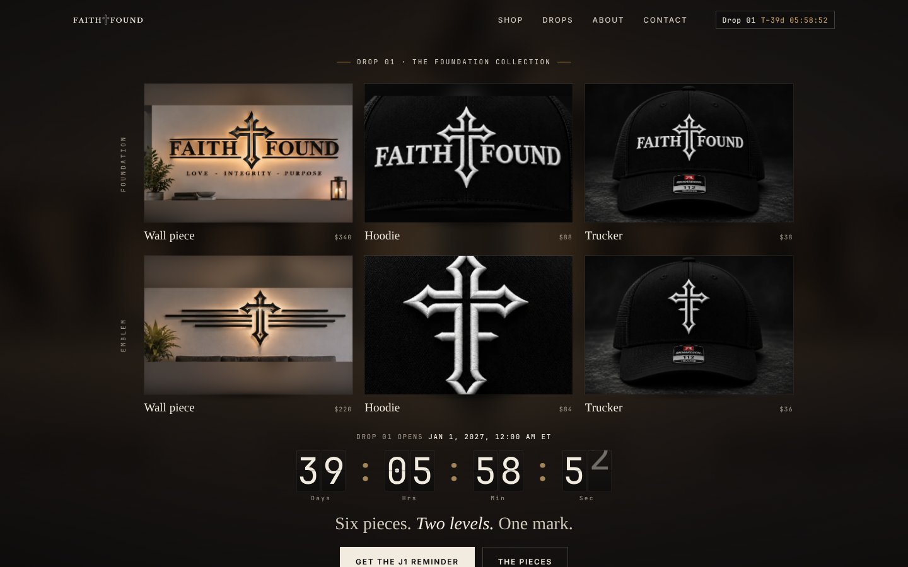

# FAITH FOUND — 3D product system, cinematics and store

Everything for Drop 01 (J1, January 1, 2027) in one place: six products in two levels plus the Flight Tag; a GoHighLevel-ready store built on the real product photos, with the falling-photos intro and J1 countdown, for phone and desktop; and 3D models with a Studio for size checks and social films.



## Open
| | |
|---|---|
| `dist/faith-found-site.html` | The store. Open it in a browser, or paste it into one GoHighLevel Custom Code element ([how](docs/06-website-and-ghl.md)). |
| `dist/faith-found-studio.html` | The Studio: every product in 3D, colours, sizes, measure, size compare, the films, Record film and Still. |

Both need an internet connection (three.js and fonts load from public CDNs).

## Docs
1. [3D principles](docs/01-3d-principles.md): the two levels, units, modelling recipes, materials, light, camera, motion, performance, path to production.
2. [Cinematics](docs/02-cinematics.md): the camera rig, every shot list, the home intro choreography, recording sizes.
3. [Product bible](docs/03-product-bible.md): SKUs, sizes, colourways, dimensions, decoration placement, manufacturer questions.
4. [Flight Tag](docs/04-flight-tag.md): construction, sizes, size comparisons, artwork rules, supplier questions.
5. [Drops and the J1 launch](docs/05-drops-and-launch.md): how the countdown works, the 40-day plan, the 12-month calendar, the vote.
6. [Website and GoHighLevel](docs/06-website-and-ghl.md): screens, install, settings, checkout links, checks.

## Edit and build
Products, drops and vote options live in `src/catalog.js`; the 3D engine in `src/engine.js`; page templates in `src/site.html` and `src/studio.html`.

```bash
python3 build.py
```

Prices, blanks and some specs are placeholders marked TBC until suppliers confirm them. Product views are 3D renders of the designs, not photographs.
