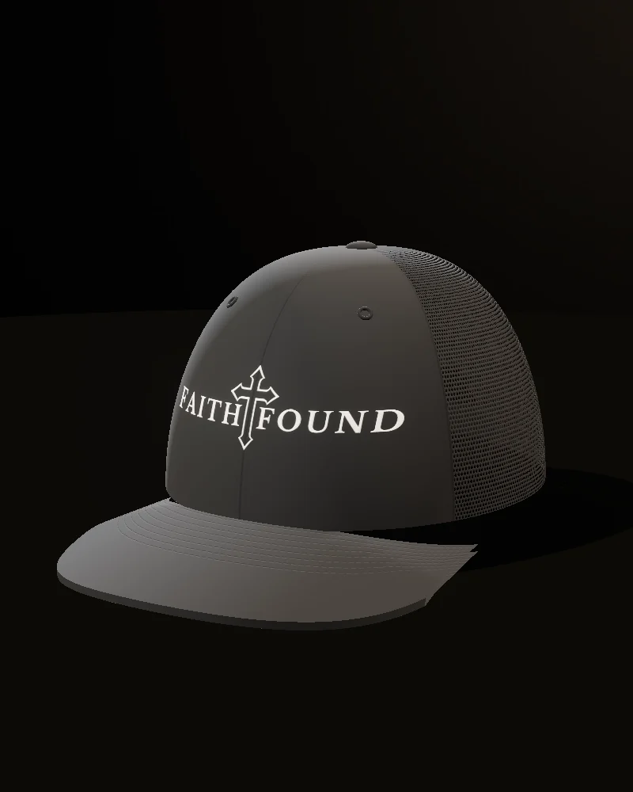
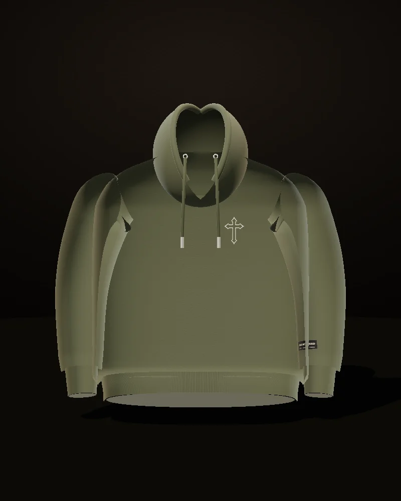
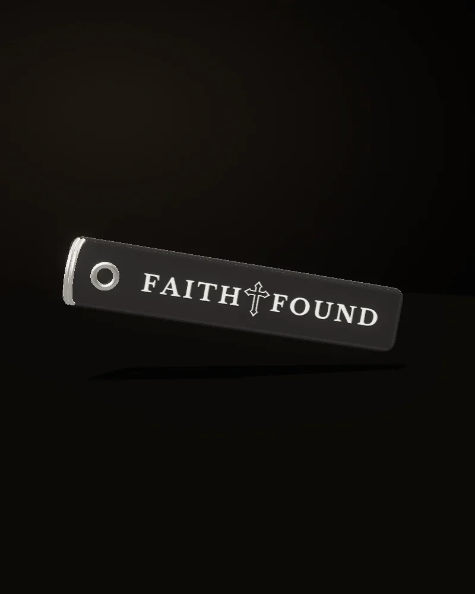

# 01 · 3D principles

How every FAITH FOUND product is modelled, lit, animated and shown, so a new product drops into the same system without new rules. The reference for look and feel is the wall-hanging set and the cap, hoodie and tag mock-ups; the reference for set-up is the wall-piece kit (camera on a target, a five-shot film, recordable frames).

   

## 1. One mark, two levels

Every product line has two levels, and the art is always drawn from the same vector paths (`src/brand.js`, extracted from the original site):

| Level | Art | Where it goes |
|---|---|---|
| **Foundation** | The lockup: FAITH, the cross, FOUND | Cap front · hoodie centre chest · wall piece with rails and LOVE – INTEGRITY – PURPOSE |
| **Emblem** | The cross alone | Cap front · hoodie left chest · wall piece with three lines either side |

Two lockup layouts exist, both measured in units of the cross height **H**:

| Layout | Used on | Text cap height | Text centre (down from cross top) | Gap from stem |
|---|---|---|---|---|
| `stacked` | caps, hoodies, wall pieces | 0.25 H | 0.60 H | 0.115 H (text tucks under the arms) |
| `wide` | flight tag, woven labels | 0.48 H | 0.52 H | 0.42 H (text sits outside the arms) |

The cross is centred on the garment or piece; FOUND is wider than FAITH, so the lockup is deliberately off-centre (as in every reference image).

## 2. Units and conventions

- **1 unit = 1 metre**, real-world scale. Product sizes in the catalog are inches; the engine converts (`IN = 0.0254`).
- **Y up, front faces +Z.** Every model is built at the origin: garments and caps stand on `y = 0`; wall pieces have their back on `z = 0` (the wall plane) and the top of the cross at `y = 0`.
- **Build first, place second.** Builders never move their own group; the stage places it. Decals are projected while the model is still at the origin, so they stay glued to the surface.
- **Measure from geometry.** Dimensions shown on the site, in the Studio and in these docs are read from the model's bounding box, not typed in. If geometry changes, the numbers change with it.

## 3. Modelling recipes

All models are procedural (code, no downloaded meshes), so a size or colour change rebuilds exactly.

| Product | Recipe | Key real-world numbers |
|---|---|---|
| **Trucker (Richardson 112)** | Crown: a dome surface, fuller at the top (profile `sin^0.72`), deeper at the front than the back. Front two panels in twill with a centre seam; four back panels in mesh (alpha-cut holes) with the snapback arch removed. Visor: a true curved surface (top, underside, rim) with 2.6/m pre-curve, a slight downward pitch and 8 stitch rows. Button, two embroidered eyelets, snap strap. | Crown 4.41 in · visor 2.91 in · visor width 7.13 in (Adult) |
| **Hoodie** | Torso: a loft of superellipse sections from hem to neck (boxy body, rounded shoulders). Rib hem and cuffs as separate lofts with a rib texture. Sleeves: swept tubes from the shoulder to just above the hem. Hood: a shell behind the neck opening forward, with rolled edges. Drawcords with metal tips, sewn-on kangaroo pocket that follows the body curve. | Chest, length and sleeve from the size table |
| **Wall piece** | Two layers of extruded steel on stand-offs. Back layer (1 in off the wall): lettering + rails, or the six lines + hidden spine. Front layer (1¾ in): the cross as an outline ring plus an inset core, leaving a fine gap that the halo shines through. LED halo painted onto the wall from the silhouette. | Depth 1.96 in · weights estimated from cut area |
| **Flight Tag** | Rounded rectangle with a punched hole, merrowed edge tube, embroidered faces both sides, two-part grommet, double split ring. | Mini 4 × 0.75 · Standard 5.5 × 1 · Large 7 × 1.25 in |

**Decoration is a decal, not a texture on the garment.** Embroidery, puff and woven labels are projected onto the surface at their real size (e.g. 9 in chest lockup), so they never stretch when the garment size changes, and the 3D placement matches the tech-pack placement.

## 4. Materials

| Material | Settings (three.js MeshPhysicalMaterial) | Notes |
|---|---|---|
| Fleece | roughness 0.94, sheen 0.55, fine noise bump | Sheen kept low so black reads black under spot lights |
| Twill (cap front, visor) | roughness 0.9, diagonal twill bump | |
| Mesh | alpha-cut holes (`alphaTest 0.5`), double-sided | Holes read up close, the panel reads solid from afar |
| Rib | vertical rib bump | Hem and cuffs |
| Embroidery | colour map + bump map painted from the vector art; satin stitch lines at 26°; puff = stronger bump | Thread colour comes from the colourway |
| Woven label | ground colour + weave lines + stitched border | |
| Matte black steel | metalness 0.2, roughness 0.74 | |
| Gunmetal | metalness 0.88, roughness 0.42 | |
| Brass | metalness 1, roughness 0.3 | "Black & Brass" = black cross over a brass lettering/lines layer |

Colourways live in the catalog (`front / mesh / visor / thread`, `body / thread / label`, `body / accent`, `ground / thread / edge`). A new colourway is a new row in the catalog; no 3D work.

## 5. Light

Three rigs, chosen by the product, never by the page:

| Rig | Used for | Set-up |
|---|---|---|
| **Studio** | caps, hoodies, tag | Seamless dark set: warm backdrop glow, unlit floor fading to black, shadow-only layer. Key: warm directional from front-left-high (casts the shadow). Two rims from behind-left (cool) and behind-right (warm) to cut the silhouette of black goods. Low hemisphere fill. ACES tone mapping, exposure 1.15. |
| **Wall** | wall pieces | Plaster or charcoal wall, oak floor, warm spot from above-left (shadow), warm fill from the right. Optional LED halo at 2700/3000/4000 K, with bloom on large screens. |
| **Niches** | home intro | A wall of six niches. Each has its own warm spot and LED strip that switch on when its product lands; a soft front fill and a cool rim make black pieces readable. |

Rules: one warm key, rims do the shaping, nothing pure white, no coloured light except the halo's warm white. Phones get the same rig without shadow maps (a soft contact shadow is drawn instead) and without bloom.

## 6. Camera

- Default lens equals 30° vertical field of view (about a 45 mm lens). Films use real lens values: 28, 35, 50, 85, 100 mm (vertical FOV 46°, 38°, 27°, 16°, 14°).
- Framing is computed from the bounding box so every size frames the same. Opening view: a 3/4 angle for garments and caps (az 0.32 rad), straight on for wall pieces.
- Orbit limits: garments and caps turn all the way round; wall pieces stop at ±69° (you can't walk behind a wall); polar angle limited so the camera never goes under the floor.
- On load the camera eases in from a wider, offset position over 1.6 s (ease-out cubic). With reduced motion it simply appears.

## 7. Motion principles

| Kind | Duration | Easing |
|---|---|---|
| UI response (buttons, swatches) | 150–250 ms | ease |
| Page and panel entrances | 400–800 ms | cubic-bezier(.2,.7,.2,1) |
| Camera moves (films) | 4–6 s per shot | ease-in-out cubic |
| Camera settle (viewer open) | 1.6 s | ease-out cubic |
| Product drop (intro) | 0.55–0.62 s fall + 0.38 s settle | gravity-style ease-in, damped bounce |
| Countdown digit change | 420 ms | slide in with slight blur |

- **Soft goods fall, steel slides.** Caps and hoodies drop with a bounce (7% squash for 0.16 s, a damped wobble); wall pieces slide straight back onto the niche wall and land with a 12 mm camera shake.
- **Light follows contact.** A niche light comes on only when its product lands, with a two-step LED flicker (60%, 20%, then up).
- **Stillness at rest.** Nothing spins on its own after the intro. The wall breathes only with your pointer (a few centimetres of parallax); on phones it drifts very slowly.
- **Reduced motion** (`prefers-reduced-motion`): no drops, no camera moves, no grain; everything appears in place.

## 8. Performance budget

| | Budget |
|---|---|
| Site file (HTML + CSS + JS + art) | ~215 KB, no images to host |
| three.js from CDN | ~170 KB gzipped, cached across pages |
| Pixel ratio | ≤ 2 desktop, ≤ 1.5 phones |
| Shadows / bloom | desktop only |
| Card images | rendered once per product in the browser (WebP), queued one at a time |
| Model cache | last 5 product/size/colour builds; older ones are disposed |
| Rendering | paused when the 3D view is off screen |

## 9. From concept model to production

These are concept models. To go further:

1. **Tech packs.** Use the decoration table in the product bible (size, placement, method) with the vector art from `src/brand.js`.
2. **Steel.** The wall-piece contours are exact; export them as DXF for the fabricator (the shapes are in `buildWall`). Confirm gauge, stand-off positions and the tagline's minimum feature size first (see the product bible).
3. **AR / "view in your room".** When final GLB and USDZ files exist (from the fabricator's CAD or a 3D artist), add them as `model3d` / `modelIos` in the catalog; the site can then hand them to the phone's AR viewer. The procedural models stay as the fast, always-available view.
4. **Photography.** Real product photos go in each product's `images` list and appear beside the 3D view; until then the renders do the job, and the site footer says so.
