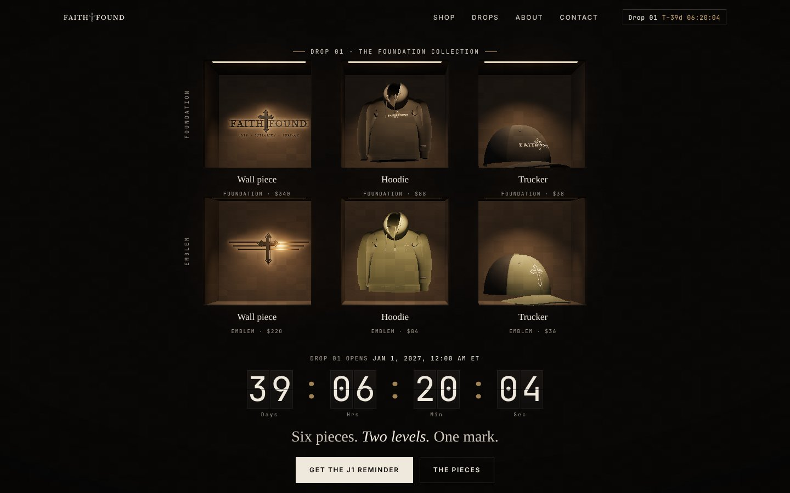

# 02 · Cinematics

How the films work, shot by shot, and how the home-screen intro is choreographed. Every film plays live in the product page (**Film** button) and can be recorded as a video in the Studio (`dist/faith-found-studio.html`).

## The camera rig

The same rig as the wall-piece kit: the camera always looks at a **focus point** and sits on a sphere around it.

```
        TOP VIEW                                   SIDE VIEW
                                                        camera
            back (-Z)                                     ●
               │                                         /
     ┌─────────┼─────────┐                              / d
     │      product      │                             /
     │         ●─────────┼── focus point              / el (elevation)
     └─────────┼─────────┘                 ──────────●──────────── floor / wall normal
               │  \                                focus
               │   \ az (azimuth, + = to the right)
               │    \
               │     ● camera                d = distance in "frame fills":
            front (+Z)                       1.0 = the product's bounding sphere
                                             fills the frame height at that lens
```

A **shot** is a move between two framings over a duration:

| Field | Meaning |
|---|---|
| `f` | Focus point: `center`, `art` (the embroidery or lettering), `label`, `visor`, `edge`, `grommet` |
| `az`, `el` | Azimuth and elevation in radians around the focus point |
| `d` | Distance in frame fills (so the same shot works at 36 in or 60 in, Youth or XL) |
| `lens` | Start and end lens in mm (full-frame): 28, 35, 50, 85, 100 |
| `spin` | Turns the product itself (the tag flip) |
| `lights` / `halo` | Brings the key lights or the LED halo up during the shot |
| `cap`, `sub` | Caption and small line; `{name}`, `{color}`, `{size}`, `{deco}` are filled in |

Moves use ease-in-out cubic. Between shots: a 0.28 s fade to black. During a film: 9% letterbox bars slide in and the caption sits above them. Portrait frames pull the camera back automatically so the product still fits.

## Shot lists

### Trucker · 24.0 s
| # | Shot | Time | Lens | Move | Caption |
|---|---|---|---|---|---|
| 1 | Reveal | 4.6 s | 50 | Straight on, push in from 2.2 to 1.45; lights rise | Product name / colour |
| 2 | Orbit | 5.6 s | 35 | Left 3/4 to right 3/4, slightly high | Richardson 112 / Structured front · mesh back |
| 3 | Stitch | 4.4 s | 100 | Macro on the embroidery, slide in | Foundation lockup or Emblem cross / Embroidered, not printed |
| 4 | Profile | 4.4 s | 85 | Side view, visor curve and mesh | Pre-curved visor / Snapback strap |
| 5 | Hero | 5.0 s | 35 → 28 | Low 3/4, pull back | FAITH FOUND / Love · Integrity · Purpose |

### Hoodie · 24.2 s
| # | Shot | Time | Lens | Move | Caption |
|---|---|---|---|---|---|
| 1 | Reveal | 4.8 s | 50 | Straight on, push in; lights rise | Name / colour |
| 2 | Orbit | 6.0 s | 35 | Front-left round to the back | Heavyweight fleece / Dropped shoulder · double-layer hood |
| 3 | Chest | 4.4 s | 100 | Macro on the chest art | Art name / Embroidered, not printed |
| 4 | Label | 4.0 s | 100 | Macro on the left-sleeve woven label | Woven label / Left sleeve |
| 5 | Hero | 5.0 s | 35 → 28 | Low angle, pull back | FAITH FOUND / Love · Integrity · Purpose |

### Wall piece · 25.6 s
| # | Shot | Time | Lens | Move | Caption |
|---|---|---|---|---|---|
| 1 | Lights on | 5.4 s | 50 | Push in while the halo fades up (0.8–3.4 s) | Name / With the LED halo, 3000K |
| 2 | Orbit | 5.4 s | 35 | Left 3/4 to right 3/4 | Cut, layered, floated / Two layers of steel |
| 3 | Detail | 4.4 s | 85 → 100 | Macro along the lettering or lines | Finish / Powder-coated steel |
| 4 | Profile | 4.4 s | 85 | Side-on at the cross edge, shows the stand-off | Floats off the wall / 1¾ in on stand-offs |
| 5 | Room | 6.0 s | 35 → 28 | Low, pull back to the room | FAITH FOUND / Love · Integrity · Purpose |

### Flight Tag · 17.6 s
| # | Shot | Time | Lens | Move | Caption |
|---|---|---|---|---|---|
| 1 | Reveal | 4.4 s | 50 | Push in; lights rise | Flight Tag / colour |
| 2 | Flip | 4.6 s | 50 | The tag turns 180° to show the back | Two sides / REMOVE BEFORE FLIGHT |
| 3 | Grommet | 4.0 s | 100 | Macro on grommet, ring and merrowed edge | Metal grommet / Merrowed edge · split ring |
| 4 | Hero | 4.6 s | 35 → 28 | Pull back, front again | FAITH FOUND / In every Drop 01 box |

Shot data lives in `FILMS` in `src/engine.js`. Add a shot by adding a row; every product of that kind gets it.

## The home intro: products falling into place



The home screen is a wall of six lit niches. **Columns are the product lines** (Wall piece, Hoodie, Trucker); **rows are the levels** (Foundation over Emblem). On a portrait phone the wall turns to two columns (Foundation | Emblem) by three rows.

| Time | What happens |
|---|---|
| 0.0 s | Black. The niche wall is there but unlit. |
| 0.0–1.2 s | Ambient, front fill and rim light rise. |
| 0.55 s + 0.3 s × n | Product n drops in (order: top row left to right, then bottom row). Soft goods fall from above and in front in 0.62 s; steel slides back onto the niche wall in 0.55 s. |
| on contact | Soft goods: 7% squash, bounce (7 cm, then 1.4 cm), damped wobble. Steel: hard stop and a 12 mm camera shake. The niche LED flickers on (60%, 20%, full by 0.45 s); wall pieces get their halo. |
| ≈ 3.6 s | All settled. Labels, row names, the eyebrow and the countdown fade in (1 s). |
| after | Pointer parallax only. Hover a niche: the product lifts 3.5 cm, turns toward you, its light brightens 35%, and a tag shows name and price. Click: the camera dives into the niche (0.75 s), fades, and opens the product page. |

- **Skip intro** (bottom right) or any click jumps to the settled state.
- The intro plays once per browser session by default (`SETTINGS.intro = 'always'` to play it every visit).
- Niche colourways are chosen so the wall reads as a set: Foundation row in Black; Emblem row in Loden (cap), Deep Olive (hoodie) and Black & Brass (wall).

## Recording for social

In the Studio: pick product, colour and size → **Film frame** → **Record film**. The whole film is recorded in real time and saved.

| Frame | Pixels | Use |
|---|---|---|
| 16:9 | 1920 × 1080 | Website, YouTube |
| 9:16 | 1080 × 1920 | Reels, TikTok, Shorts |
| 1:1 | 1080 × 1080 | Feed |
| 4:5 | 1080 × 1350 | Feed (tallest) |

30 fps, about 16 Mbps. Chrome and Edge save `.webm`; Safari saves `.mp4`. **Still** saves a PNG at the frame's full resolution. The deep links `?p=<product-id>&c=<colour>&s=<size>` open the Studio on a product (e.g. `faith-found-studio.html?p=wall-emblem&c=2&s=1`).

### A simple content calendar from the films (pre-launch)
- One product film per post, Foundation then Emblem for each line (six posts).
- Flight Tag "Flip" cut as a 5-second loop for stories.
- The home intro screen-recorded on a phone as the J1 teaser.
