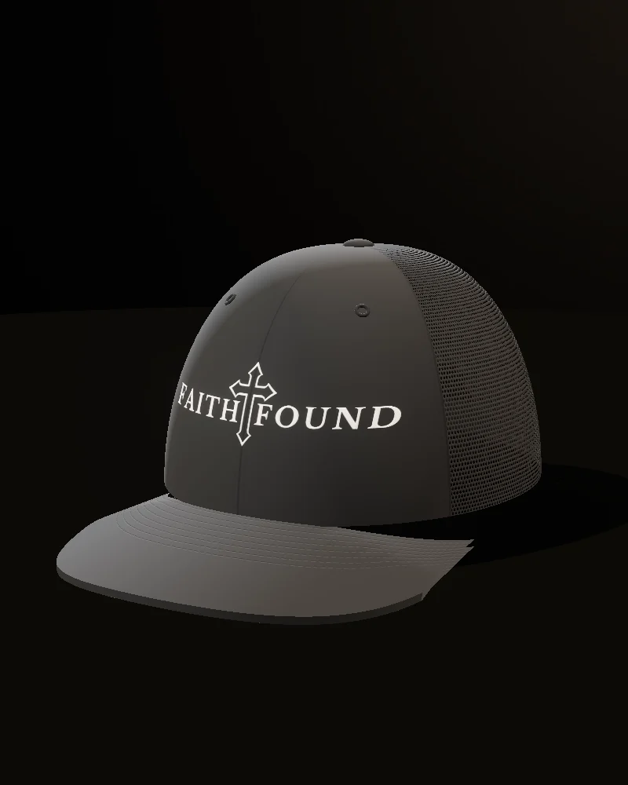
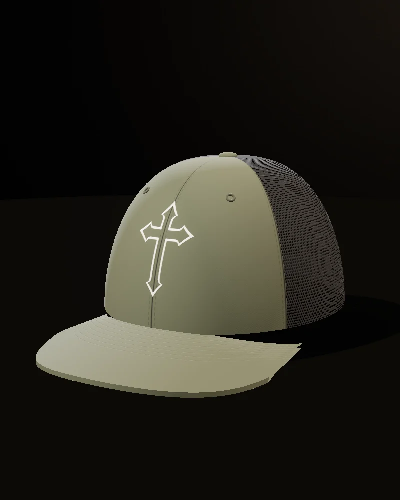
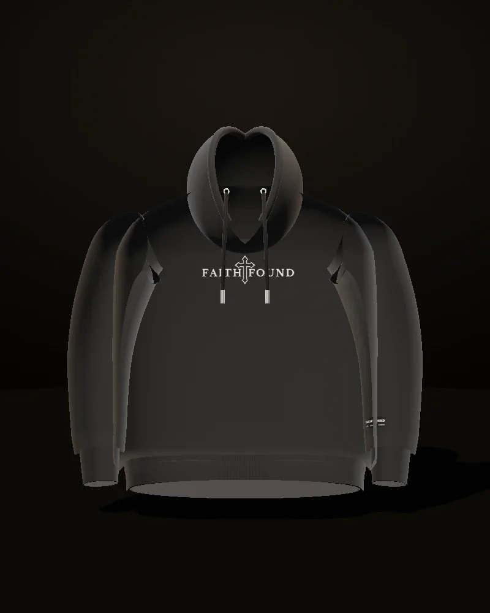
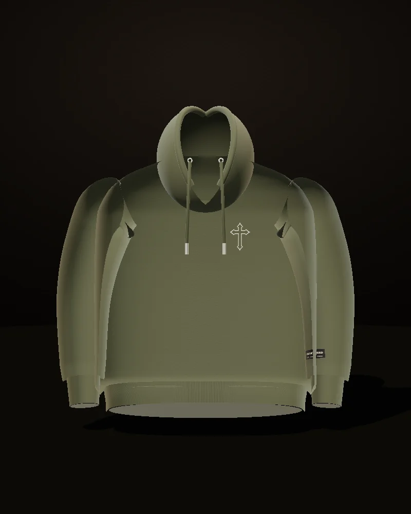
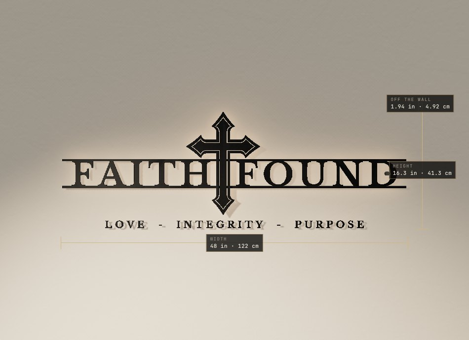

# 03 · Product bible — Drop 01

Six products in three lines, each line in two levels, plus the Flight Tag. Every product has three sizes and three colourways as the starting options; final blanks, colour names and decoration specs are confirmed with each manufacturer (marked **TBC**). Prices are placeholders.

All data below lives in `src/catalog.js`. Dimensions marked "from the model" are measured from the 3D geometry.

| SKU | Product | Line | Level | Sizes | Colours | Price |
|---|---|---|---|---|---|---|
| FF-TRK-FDN | Foundation Trucker | Trucker | Foundation | Youth · Adult · Adult L–XL | Black · Charcoal/Black · Loden/Black | $38 |
| FF-TRK-EMB | Emblem Trucker | Trucker | Emblem | Youth · Adult · Adult L–XL | Black · Charcoal/Black · Loden/Black | $36 |
| FF-HOD-FDN | Foundation Hoodie | Hoodie | Foundation | M · L · XL | Black · Deep Olive · Bone | $88 |
| FF-HOD-EMB | Emblem Hoodie | Hoodie | Emblem | M · L · XL | Black · Deep Olive · Bone | $84 |
| FF-WAL-FDN | Foundation Wall Piece | Wall piece | Foundation | 36 · 48 · 60 in | Matte Black · Gunmetal · Black & Brass | $340 / $460 / $620 |
| FF-WAL-EMB | Emblem Wall Piece | Wall piece | Emblem | 24 · 30 · 36 in tall | Matte Black · Gunmetal · Brushed Brass | $220 / $290 / $380 |
| FF-TAG-STD | Flight Tag | Accessory | — | Mini · Standard · Large | Black/White · Olive/Bone · Bone/Black | $12 / $14 / $16 |

---

## Trucker — Richardson 112

 

**Blank:** Richardson 112 trucker: structured mid-profile 6-panel, pre-curved visor, adjustable snapback; cotton-poly twill front, polyester mesh back (per Richardson's spec sheet).

| | From the model (Adult) |
|---|---|
| Crown height | about 3¾ in |
| Visor length | about 2¾ in |
| Visor width | about 7¼ in |

These follow the published Richardson 112 profile (structured mid-profile, pre-curved visor). Confirm them against Richardson's current spec sheet before production; the 3D model reads them from `R112` in `src/engine.js`.

| Fit | Head size | Blank |
|---|---|---|
| Youth | about 20½–22½ in (52–57 cm) | Youth trucker blank, **TBC** |
| Adult | about 21¾–24 in (55–61 cm) | Richardson 112, one size, snapback |
| Adult L–XL | about 22¾–24¾ in (58–63 cm) | Larger-fit trucker blank, **TBC** |

The 112 itself is one size. Youth and L–XL need matching blanks from the supplier; confirm they exist in the same colours before listing them.

| Colourway | Front / visor | Mesh | Thread |
|---|---|---|---|
| Black | Black | Black | White |
| Charcoal / Black | Charcoal | Black | White |
| Loden / Black | Loden | Black | Bone |

**Decoration**

| Level | Art | Size | Placement | Method |
|---|---|---|---|---|
| Foundation | Lockup (stacked) | 4.5 × 1.41 in | Front, cross on the centre seam, centred about 2 in above the visor seam | Cross in 3D puff; FAITH FOUND in flat satin |
| Emblem | Outline cross | 1.79 × 2.5 in | Front, on the centre seam, centred about 2⅛ in above the visor seam | 3D puff, outline |

Ask the embroiderer: the 112's maximum front area (commonly about 4.5 × 2.25 in); the smallest puff stroke they can run (the cross outline is about 1.5 mm wide at 2.5 in tall, so puff may need a bolder outline); whether the 0.35 in letters need their serifs thickened. A digitised, embroidery-safe version of the lockup is the first deliverable.

---

## Hoodie — heavyweight pullover

 

**Blank (TBC):** heavyweight cotton fleece, about 13–14½ oz (450–500 gsm), brushed inside; relaxed fit, dropped shoulder; double-layer hood with flat drawcords and metal tips; kangaroo pocket; 2×1 rib cuffs and hem.

| Size | Chest (flat, pit to pit) | Body length (HPS) | Sleeve (centre back) |
|---|---|---|---|
| M | 23.5 in · 59.7 cm | 27.5 in | 34.5 in |
| L | 24.5 in · 62.2 cm | 28.5 in | 35.5 in |
| XL | 25.75 in · 65.4 cm | 29.5 in | 36.5 in |

Launch sizes are M, L and XL; S and 2XL are the first candidates to add (see the vote in the drop plan). Grade the blank's own spec sheet into this table when the blank is chosen.

| Colourway | Body | Embroidery thread | Sleeve label |
|---|---|---|---|
| Black | Black | White | Black label, white weave |
| Deep Olive | Olive | Bone | Black label, bone weave |
| Bone | Bone | Ink (near black) | Black label, white weave |

**Decoration**

| Level | Art | Size | Placement | Method |
|---|---|---|---|---|
| Foundation | Lockup (stacked) | 11 × 4.1 in | Centre chest; top of cross 4½ in below the front neck seam | Flat satin |
| Emblem | Outline cross | 2.33 × 3.25 in | Left chest (wearer's left); centre 4 in from centre front; top 7½ in below the high point of the shoulder | Flat satin, outline |
| Both | Woven label | 2.75 × 1.0 in | Left sleeve, outer side, 2 in above the cuff seam | Damask woven, sewn on 4 sides |

Back: blank on both levels (as in the references). Inside neck: a matching woven brand label (TBC with the blank supplier: tear-away or relabel).

---

## Wall piece — two layers of cut steel



**Construction (TBC with the fabricator):** laser-cut steel, powder coated. Back layer 3 mm (11 ga) on 1 in stand-offs; front cross 4.8 mm (3/16 in) on 1¾ in stand-offs. Overall depth off the wall 1.96 in. Drilling template and hardware in the box. Optional warm LED halo (3000 K strip and plug-in driver) as an add-on.

**Foundation** (from the model)

| Size | Width × height | Cross height | Est. steel weight |
|---|---|---|---|
| 36 in | 36 × 12.2 in (91 × 31 cm) | 10.8 in | ~2.6 lb (1.2 kg) |
| 48 in | 48 × 16.3 in (122 × 41 cm) | 14.3 in | ~4.6 lb (2.1 kg) |
| 60 in | 60 × 20.3 in (152 × 52 cm) | 17.9 in | ~7.2 lb (3.3 kg) |

Back layer: FAITH and FOUND with a rail along the cap line and one along the baseline. The rails touch the letters, so all the lettering is **one cut piece** that hangs straight from two stand-offs. LOVE – INTEGRITY – PURPOSE sits below the cross.

**Emblem**: the cross alone, cut as an outline with an inset core (a fine gap lets the halo light through), floated 1¾ in off the wall on four hidden stand-offs. The finish covers the whole cross.

| Size (height) | Width × height | Plate |
|---|---|---|
| 24 in | 17.2 × 24 in | 3/16 in steel |
| 30 in | 21.5 × 30 in | 3/16 in steel |
| 36 in | 25.8 × 36 in | 3/16 in steel |

| Colourway | Foundation (cross / lettering) | Emblem (whole cross) |
|---|---|---|
| Matte Black | Matte black / matte black | Matte black |
| Gunmetal | Gunmetal / gunmetal | Gunmetal |
| Black & Brass / Brushed Brass | Matte black / brass | Brushed brass |

**Questions for the fabricator**
- Gauge and finish: 11 ga back layer, 3/16 in cross, powder coat vs. plated brass.
- **Minimum feature size.** LOVE – INTEGRITY – PURPOSE is about 1 in tall on the 48 in piece; the serif hairlines (about 1.3 mm) are thinner than 3 mm steel. Options: thicken the hairlines, cut the tagline from thinner steel, or engrave it on a slim bar. Same check for the lettering at 36 in.
- Stand-off positions and wall anchors (two for the back layer, three for the cross).
- LED strip, diffuser, channel and driver for the halo; UL listing.
- Packaging for 60 in pieces.

---

## Flight Tag

See [04 · Flight Tag](04-flight-tag.md) for the full development sheet.

---

## How to add a product (same structure every time)

Copy a product object in `src/catalog.js` and change:

```
id, sku, line, cat, level, name, model (cap | hoodie | wall | tag), art (lockup | emblem | tag),
drop, status ('auto' = goes live on its drop date), price,
sizes[ {id, label, price?, ...dimensions} ], colors[ {id, name, hex, ...part colours} ],
blurb, story, details[], deco[ {where, art, w, h, method, note} ], care, inBox[], images[], buyUrl{}
```

If it is a new kind of object (a beanie, a tee, a desk nameplate), add a builder in `src/engine.js` and a shot list in `FILMS`; everything else (cards, product page, measuring, films, thumbnails) works automatically.
