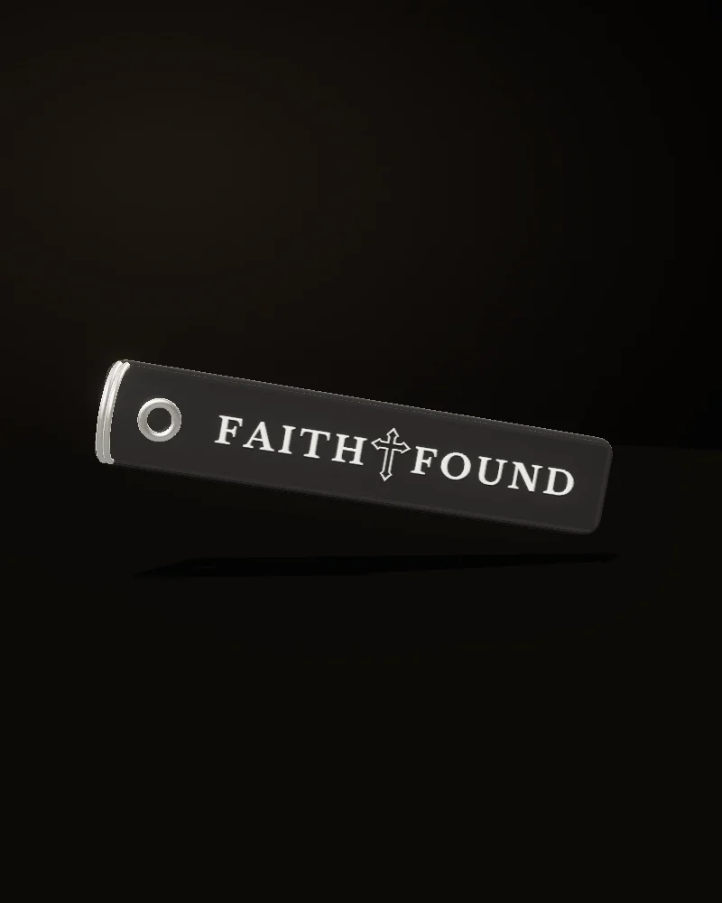
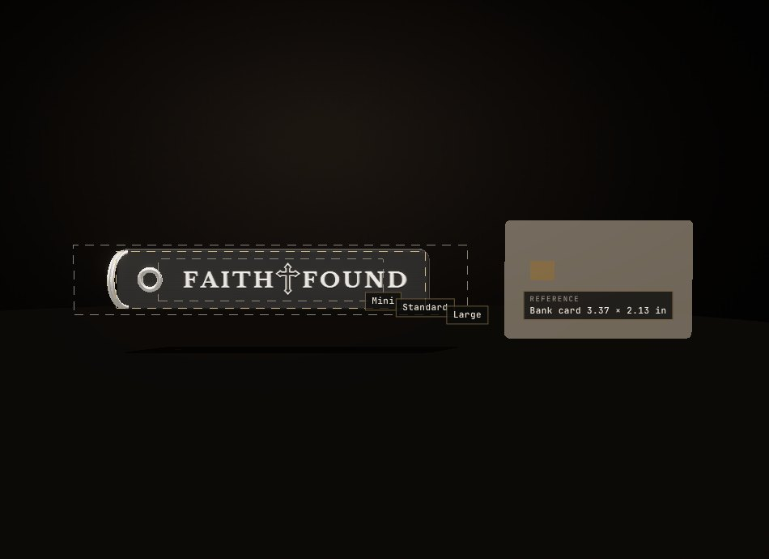

# 04 · Flight Tag — product development

The classic aviation "REMOVE BEFORE FLIGHT" key tag, made ours: **FAITH ✝ FOUND** on the front, **REMOVE BEFORE FLIGHT** on the back. It goes in every Drop 01 box, then sells on its own from Drop 02 (Mar 1, 2027).

## Construction

| | Spec |
|---|---|
| Body | Twill, embroidered both sides (two embroidered faces bonded, or one double-sided piece — TBC with supplier) |
| Edge | Merrowed (overlocked) border, colour-matched to the ground |
| Thickness | About 2 mm |
| Hardware | One metal grommet (nickel), 1 in (25 mm) split ring |
| Front | Wide lockup: cross between FAITH and FOUND, text outside the arms |
| Back | REMOVE BEFORE FLIGHT, condensed bold sans |
| Grommet position | Centred on the height, its centre 0.55 × the tag height from the left end |
| Art area | Starts 1.12 × height from the left end (clear of the grommet), ends 0.3 × height from the right |

## Sizes

| Size | Length × height | Metric | Front lockup (approx.) | Price |
|---|---|---|---|---|
| Mini | 4.0 × 0.75 in | 10.2 × 1.9 cm | 2.9 × 0.45 in | $12 |
| **Standard** | **5.5 × 1.0 in** | **14.0 × 2.5 cm** | **4.1 × 0.62 in** | **$14** |
| Large | 7.0 × 1.25 in | 17.8 × 3.2 cm | 5.2 × 0.80 in | $16 |

Standard is the size in every Drop 01 box. Its proportions (5.5 : 1) match the reference tags.

### Size comparisons

| Compared with | Mini 4.0 in | Standard 5.5 in | Large 7.0 in |
|---|---|---|---|
| Bank card (3.37 × 2.13 in) | about 1.2 cards long | about 1.6 cards long | about 2.1 cards long |
| A large phone (about 5.8 in tall) | about ⅔ | just shorter | about 1.2× |
| A US dollar bill (6.14 × 2.61 in) | shorter | a little shorter | a little longer |
| Height vs. a bank card's short side (2.13 in) | about ⅓ | about ½ | about ⅗ |

The Studio and the product page show these live: **Compare** draws the three size outlines and a bank card next to the tag.

## Colourways

| Colourway | Ground | Thread | Edge |
|---|---|---|---|
| Black / White | Black | White | Black |
| Olive / Bone | Olive | Bone | Dark olive |
| Bone / Black | Bone | Ink | Bone |

## Artwork rules
- Text height: the Standard front letters are about 0.30 in (7.6 mm) tall, the back letters about 0.42 in. Mini drops to about 0.2 in; ask the supplier whether Mini needs the back text shortened or bolder.
- Use the `wide` lockup (see 3D principles); never squeeze the stacked lockup onto a tag.
- Keep 1/8 in clear inside the merrow.
- Alternative back (option for later drops): LOVE · INTEGRITY · PURPOSE. At Standard size its letters would be about 3 mm tall, too small to embroider cleanly; it only works on the Large tag.

## Packaging use
- Drop 01: Standard Black/White tag clipped to each order's packing card ("In every Drop 01 box").
- Hang it from the cap's adjuster or a hoodie drawcord in product photography, as the reference shows.

## Questions for the supplier
1. Minimum order per colourway and per size; price breaks at 250 / 500 / 1,000.
2. Double-sided construction and how the back is finished.
3. Grommet finish options (nickel, black, brass) and ring size.
4. Thread colour matches to our White (#F1EDE6), Bone (#EBE2CC) and Ink (#151413).
5. Lead time for a sample and for the run, so Drop 01 boxes have them by late December.
