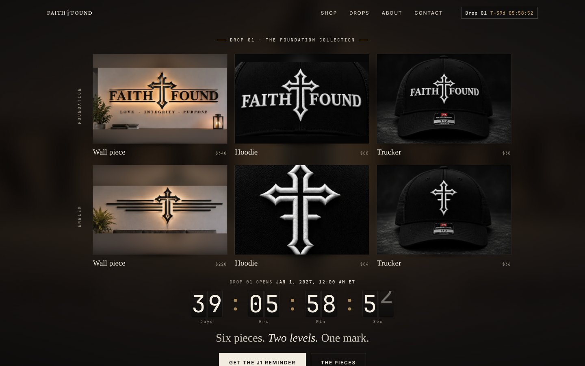
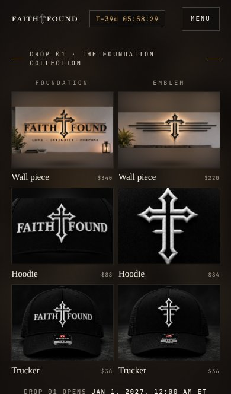
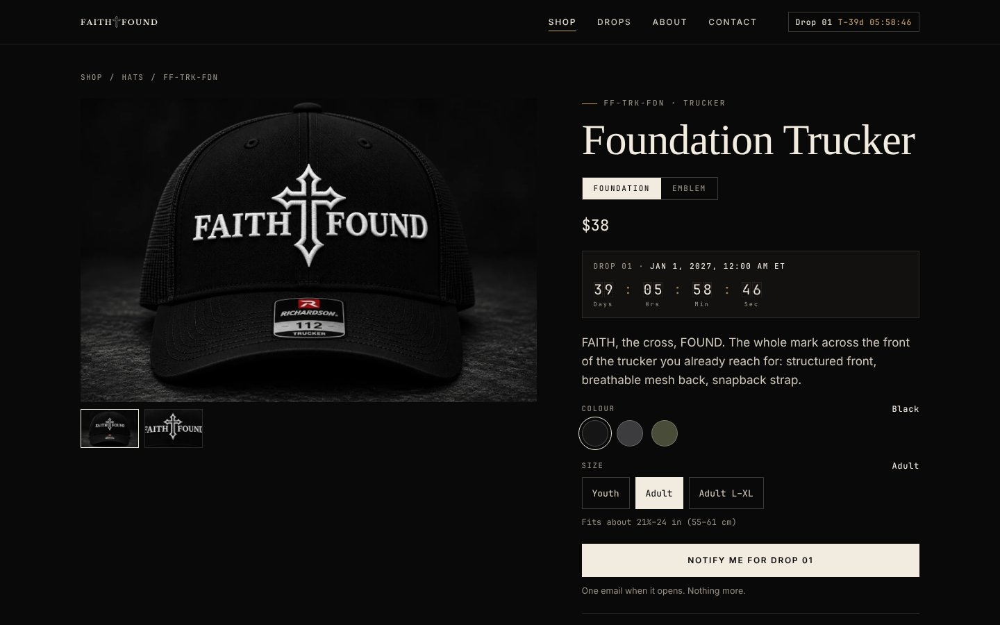
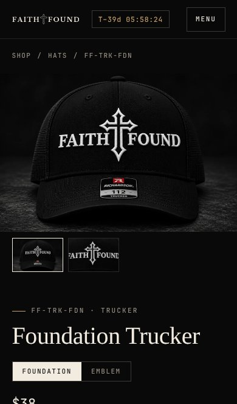

# 06 · Website and GoHighLevel

The store is one self-contained block of HTML: `dist/faith-found-site.html`. It keeps the simplicity of the original site (one Custom Code element, a SETTINGS block, hash routing, GHL forms or webhook) and is built on the real product photos in `assets/photos/` (embedded in the file). It adds the falling-photos intro, the J1 countdown, photo galleries with zoom, to-scale size guides, an optional 3D view for wall pieces and the tag, and the Drops page with voting.

**Photos.** Every image on the site comes from `assets/photos/*.webp`. To add or replace one, drop a `.webp` in that folder, reference its file name (without `.webp`) in the product's `images` list in `src/catalog.js`, and run `python3 build.py`. To keep the paste small, you can instead upload photos to the GHL media library and map them in `SETTINGS.imageUrls`. The hoodie pages currently show the embroidered mark; add the hoodie photos the same way.

| Desktop | Phone |
|---|---|
|  |  |
|  |  |

## Screens

| Screen | Address | What it does |
|---|---|---|
| **Home** | `#home` | The six product photos drop into a grid (rows Foundation / Emblem, columns Wall piece / Hoodie / Trucker; two columns on phones), land with a small bounce, and their light comes on; then the J1 countdown, "Get the J1 reminder" and "The pieces". Below: the two levels in embroidery close-ups, the Drop 01 grid, the lit wall piece, the Flight Tag, why we exist, the 12-month timeline, the wall designs on the bench (vote), values. |
| **Shop** | `#shop`, `#shop/hats`, `#shop/apparel`, `#shop/home`, `#shop/accessories` | All pieces or one category. Cards use images rendered from the 3D models (or your photos when added). |
| **Product** | `#p/<product-id>` | Photo gallery (click to zoom on desktop, tap for full screen on phones). Wall pieces and the tag add a **3D · Size** view with dimensions and a 5′10″ person or a bank card for scale. Level switch (Foundation ⇄ Emblem), colour (with a note when the photo shows another colour), size, price by size, countdown until its drop, then Notify me or Buy. Details, a to-scale **Size guide** (sofa and person for wall pieces, bank card for the tag), Decoration, In the box, Care, Shipping. |
| **Drops** | `#drops` | The countdown to the next drop, every drop for the year with its status, and the vote. |
| **About**, **Contact** | `#about`, `#contact` | From the original site. One line changed: the old "No countdown timers" now reads "Our drops have dates so you know when to look, not to rush you." |

Header: wordmark, Shop / Drops / About / Contact, and a live **T-minus** chip to the next drop. On phones the menu becomes a full-screen list.

## Install on GoHighLevel

1. Build (or use the file in `dist/`): `python3 build.py`.
2. In GoHighLevel, open the funnel or website page → add a full-width **Section** with zero padding → a full-width **Row** → **Custom Code** element.
3. Open `dist/faith-found-site.html`, copy **everything from the `FAITH FOUND website` comment to `END FAITH FOUND`**, paste it into the Custom Code element, save.
4. Hide GHL's own page header and footer for this page (the site has its own).
5. Edit the **SETTINGS** block near the top of the second script:

| Setting | What to put |
|---|---|
| `webhookUrl` | A GHL workflow **Inbound Webhook** URL. Sign-ups, Notify me, votes and contact messages post here. |
| `signupFormUrl`, `contactFormUrl` | Optional: a GHL form share link; when set, those forms are shown in an iframe instead. |
| `contactEmail`, `contactPhone`, `social` | Shown on Contact and in the footer when filled. |
| `timeZone`, `timeZoneLabel` | Used to print drop times (default America/New_York, "ET"). |
| `intro` | `'session'` (once per visit) or `'always'`. |
| `popupDelaySeconds` | The J1 sign-up pop-up, this many seconds after the intro (0 = never). |
| `shippingText` | Shipping and returns line on every product page. |
| `showSetupNotes` | Set to `false` once forms and checkout links are connected. |

6. **Checkout links.** For each product in `FF_CATALOG`, set `buyUrl` to your GHL product or order-form links, per size id or one `default`:
   `buyUrl: { osfa: 'https://…', youth: 'https://…' }` or `buyUrl: { default: 'https://…' }`.
7. **Photos (optional).** Add image URLs (GHL media library) to a product's `images` list; they appear on its card and beside the 3D view.

### Webhook fields
Every built-in form sends `application/x-www-form-urlencoded`: `email`, `consent`, `name`, `phone`, `message` (contact), `requests`, `other` (vote), `source` (`faithfound-site:signup | notify | vote | contact`), `context` (product id for Notify me), `next_drop`, `page`.

## Checks before J1
- Open the page on a phone and a laptop; let the intro play; tap a niche.
- Add `?preview=live` to the address to see the after-launch site (Buy buttons, "Drop 01 is open").
- Submit each form once and confirm it arrives in GHL.
- Turn on reduced motion in the phone's accessibility settings and reload: the wall appears without the drop.

## Behaviour and fallbacks
- **3D is optional:** three.js loads only when someone opens a 3D view; if it can't load, that view says so and the photos carry on.
- **Performance:** the page is about 1.3 MB with the photos embedded (about 0.3 MB if photos are served from the GHL media library).
- **Accessibility:** keyboard focus rings, labelled controls, countdown announced as a sentence, reduced-motion respected.
- **Browsers:** current Chrome, Edge, Safari (iOS 16+), Firefox.

## Files

| File | Purpose |
|---|---|
| `src/catalog.js` | Products, drops, vote options: the single source of truth |
| `src/brand.js` | The cross, wordmark and tagline vectors (generated from the original site by `tools/extract_brand.py`) |
| `src/engine.js` | The 3D engine: builders, viewer, films, measure/compare, home showcase, thumbnails |
| `src/site.html` | Site template (CSS, pages, SETTINGS) |
| `assets/photos/` | The product photos (cropped from the mock-ups) |
| `src/studio.html` | Studio template |
| `build.py` | Inlines everything into `dist/` |
